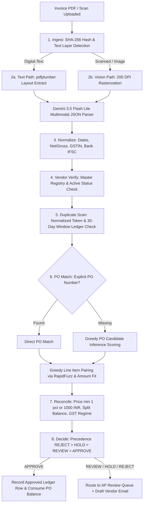

# Kestrel AP · Invoice Desk

**Live Deployments:**
- **Web Application (Vercel):** https://zamp-invoice-agent.vercel.app
- **API Backend (Render):** https://zamp-invoice-agent-api.onrender.com
- **Database (Neon Postgres):** Singapore (`ap-southeast-1`), pooled connection
- **Video & Demo Guide:** [`DEMO_CHECKLIST.md`](./DEMO_CHECKLIST.md)

---

## 1. What It Does

Kestrel AP is an automated Accounts Payable invoice processing system built for **Kestrel Foods Pvt. Ltd.** (Bengaluru, Karnataka, GST State 29). It ingests multi-page vendor invoice PDFs, extracts structured data using layout-aware multimodal AI, performs 2-way PO matching and 19 deterministic reconciliation checks, and outputs an explainable decision with real-time execution streaming:
- **`APPROVE`**: Line items, quantities, pricing, and GST match open POs within tolerance. Automatically commits to the purchase ledger and schedules payment.
- **`REVIEW`**: Discrepancies detected (split PO quantity overruns, unbilled services, price variances). Generates an actionable AP review packet and drafted vendor correction email.
- **`HOLD`**: Fraud quarantine triggered when remittance bank accounts differ from vendor master. Halts payment and blocks email communication until out-of-band phone verification is confirmed.
- **`REJECT`**: Hard commercial invalidity (duplicate invoices via number normalization, buyer GSTIN mismatch, inactive vendor, closed PO).

> **Architectural Principle:** The LLM (Gemini 3.5 Flash Lite) is used **strictly as a perceptual parser** emitting typed JSON with field confidence scores. **Deterministic Python code makes 100% of the business and financial decisions.**

---

## 2. Process Architecture



---

## 3. Edge Case Handling

| Fixture | Scenario | Challenge | Decision & Behavior |
|---|---|---|---|
| **F01** | Standard Invoice | 3 lines, different wording vs PO, clean totals | **APPROVE**: Greedy line matching pairs items; PO marked 100% billed. |
| **F02** | Split PO Overrun | Framework PO for 50 trips; 40 already billed; bills 14 | **REVIEW**: Ledger-wide consumption detects 4-trip overage. Recommends paying 10 and requesting a credit note. |
| **F03** | 200 DPI Scanned Image | 0 text characters, missing PO number, 2 open candidate POs | **REVIEW**: Vision OCR extracts table; candidate inference scores PO-2026-0431. Inferred POs never auto-pay. |
| **F04** | Duplicate Resubmission | Prior invoice reformatted (`BIS-INV-2026-0089` resent as `BIS/INV/26/89`) and re-dated | **REJECT**: Token normalization catches it as a duplicate of ledger invoice BIS-INV-2026-0089. |
| **F05** | Bank Change Fraud | All numbers & line items perfect; bank account changed | **HOLD**: Flags bank mismatch. Blocks automated email reply; requires phone callback. |
| **F06** | Partial Invoice | Bills 10 trips within balance on framework PO | **APPROVE**: Successfully consumes balance without overrunning. |
| **F07** | GST-Inclusive Pricing | Unit prices printed inclusive of 5% GST | **APPROVE**: Back-calculates net values to prevent false price variance alarms. |
| **F08** | Inactive Vendor / Closed PO | Vendor deactivated 2026-09-30; PO-2026-0377 closed | **REJECT**: Two independent reject reasons (C05 inactive vendor, C12 closed PO). |
| **F09** | Missing Mandatory Fields | Invoice number and invoice date both blank | **REVIEW**: C01 flags the gaps; duplicate matching degrades to amount-and-vendor only. Drafts a vendor email requesting a corrected tax invoice. |

---

## 4. Key Assumptions

1. **Two-Way Match**: Reconciles invoices against Purchase Orders and prior ledger history. Three-way match (Warehouse Goods Receipts / GRN) is the next milestone.
2. **Deterministic Tolerances**: Line item price tolerance is `min(1.0%, ₹1,000.00)`. Line quantity tolerance is 0% (no unauthorized overages).
3. **Ledger Commitments**: Only `APPROVED` invoices consume PO line balances; items in review do not hold balance.
4. **Fraud Safeguards**: Bank detail modifications trigger an immediate `HOLD` and silence outbound email notifications.
5. **Tax Regime**: Indian GST rules. Vendor state 29 vs Buyer state 29 determines Intrastate (CGST+SGST) vs Interstate (IGST).

---

## 5. Local Development & Testing

### Prerequisites
- Python 3.12+
- Node.js 20+

### Setup & Run Backend
```bash
# In backend directory
python -m venv .venv
source .venv/bin/activate  # Or on Windows: .venv\Scripts\activate
pip install -r requirements.txt
cp .env.example .env

# Run FastAPI server
uvicorn app.main:app --reload --port 8000
```

### Setup & Run Frontend
```bash
# In frontend directory
npm install
npm run dev  # Vite dev server runs at http://localhost:5173
```

### Run Verification Test Suites
```bash
# Backend test suite (69 tests covering money, gstin, matching, checks, golden fixtures, API)
pytest backend/tests

# Frontend unit tests (11 Vitest tests covering money formatting, INR lakh/crore, stream reducer)
npm --prefix frontend run test

# Production live verification script
python backend/scripts/verify_production.py
```

---

## 6. Next Steps & Roadmap

1. **Three-Way Matching**: Integrate ERP Warehouse Goods Receipt Notes (GRN) to verify physical delivery before payment release.
2. **Inbox Webhook Ingestion**: Ingest incoming invoices directly via Gmail / Microsoft 365 IMAP webhooks.
3. **Live GSTIN Verification**: Connect to the GSTN Portal API for real-time vendor GST status and e-Invoice IRN validation.
4. **ERP Synchronization**: Auto-post approved entries to Tally, SAP, or NetSuite with generated payment batch files.
