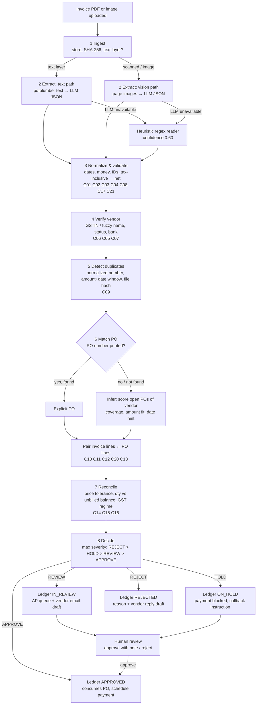

# 02 · Process map

Read in: **Phase 0** (skim), **Phase 4** (all), **Phase 9** (for narration).

## 2.1 The manual process we are replacing
1. AP clerk opens the invoice email, downloads the PDF.
2. Reads vendor, invoice number, PO, lines, totals.
3. Opens the vendor master to confirm the vendor is approved; glances at bank details.
4. Searches the PO spreadsheet; compares prices and quantities by eye.
5. Rarely: checks whether this invoice was already paid.
6. Approves, or emails someone.
Failure points: tired eyes on totals, no cumulative view of split POs, duplicate resends with a new number format, bank-change fraud that looks perfect.

## 2.2 Automated flow

## 2.3 Decision points (what the process decides and why)
| Point | Decision | Why it matters |
|---|---|---|
| Text layer? | text vs vision extraction | Text is cheaper and more exact; vision handles scans. |
| Confidence < 0.80? | Route to human | Never act on a value the reader is unsure about. |
| Vendor found by GSTIN or name? | Identity confidence | Name-only match with a different GSTIN is an impersonation signal → HOLD. |
| Bank details differ? | HOLD, not REVIEW | Most expensive AP fraud; looks perfect otherwise. Must be verified out-of-band, so no email reply. |
| Duplicate? | Normalized number vs near match | Resends rarely reuse the exact string. |
| PO printed? | Explicit vs inferred | Inferred PO is a suggestion, never an auto-approval (policy flag). |
| Quantity ≤ unbilled? | Cumulative view | Split invoices look fine individually. |
| Price within min(1%, ₹1,000)? | Tolerance | Absolute cap stops 1% of a large PO becoming a large overpayment. |
| Severity aggregation | Single decision | Deterministic precedence makes every outcome explainable. |

## 2.4 Edge cases (the four we demo, plus four more covered)
| ID | Fixture | Scenario | Why it is non-trivial | Expected |
|---|---|---|---|---|
| EC1 | F02 | Third partial invoice on a framework PO bills 14 trips when 10 remain | Every single-invoice check passes; only ledger-wide cumulative consumption catches it | REVIEW, recommend paying 10 and asking for PO amendment |
| EC2 | F03 | Scanned image, no PO number, vendor has two open POs | Needs vision extraction and PO inference with an explainable score | REVIEW with inferred PO-2026-0431 |
| EC3 | F04 | Resent invoice with reformatted number and new date | Exact string match misses it | REJECT as duplicate of BIS-INV-2026-0089 |
| EC4 | F05 | All numbers perfect, bank account changed in the footer | Looks like the happy path; fraud signal | HOLD, payment blocked, callback required |
| + | F06 | Partial invoice within balance | Contrast for EC1 | APPROVE |
| + | F07 | GST-inclusive pricing | Naive compare shows +5% variance | APPROVE after net conversion |
| + | F08 | Inactive vendor, closed PO | Multiple independent reject reasons | REJECT |
| + | F09 | Missing invoice number and date | Duplicate check degrades gracefully | REVIEW + vendor email |
